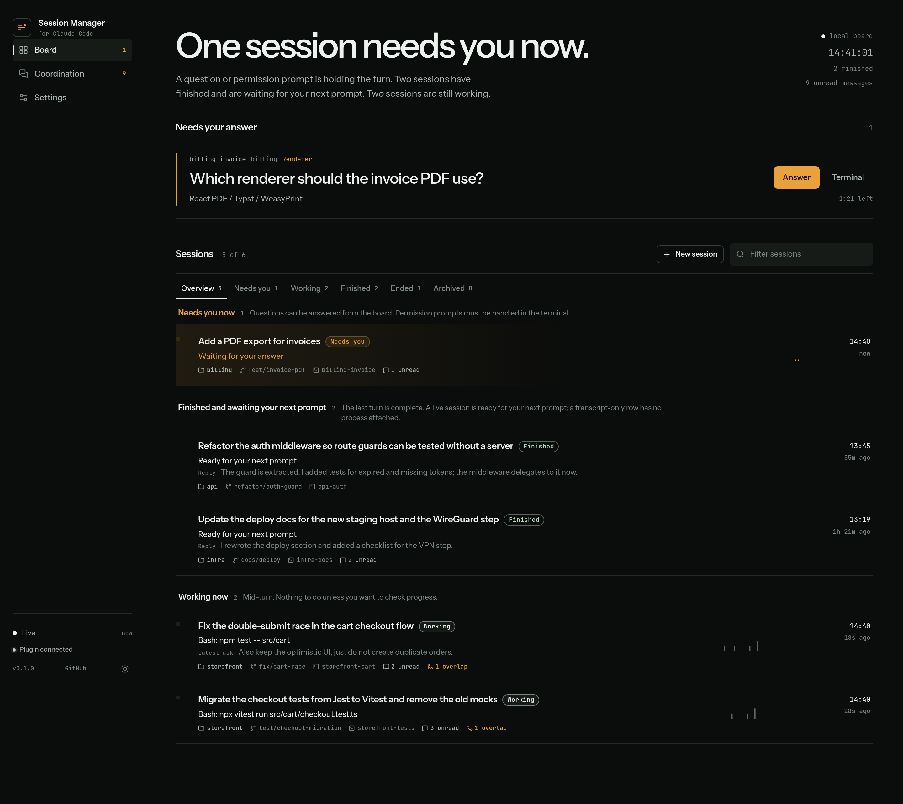
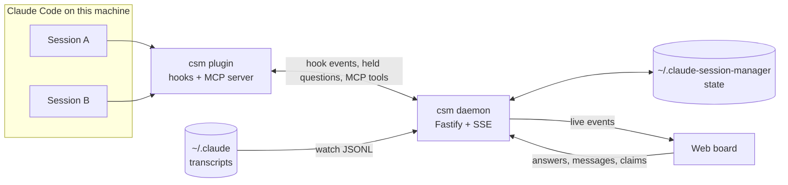
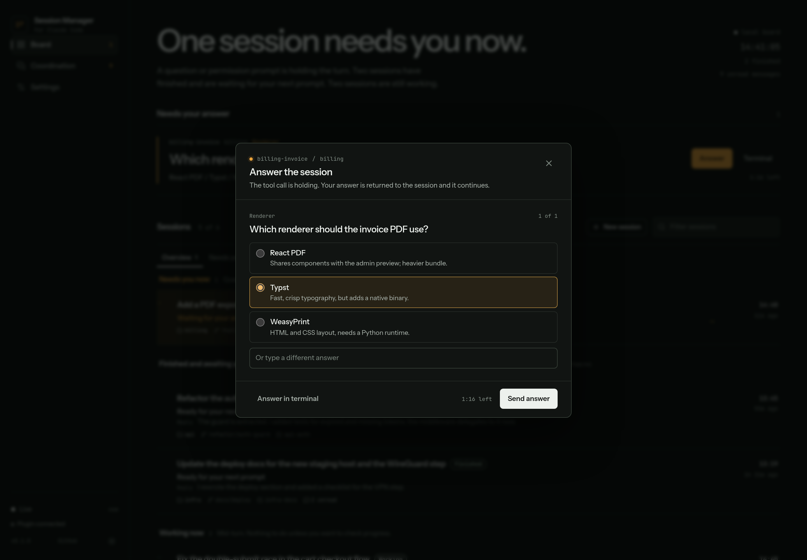
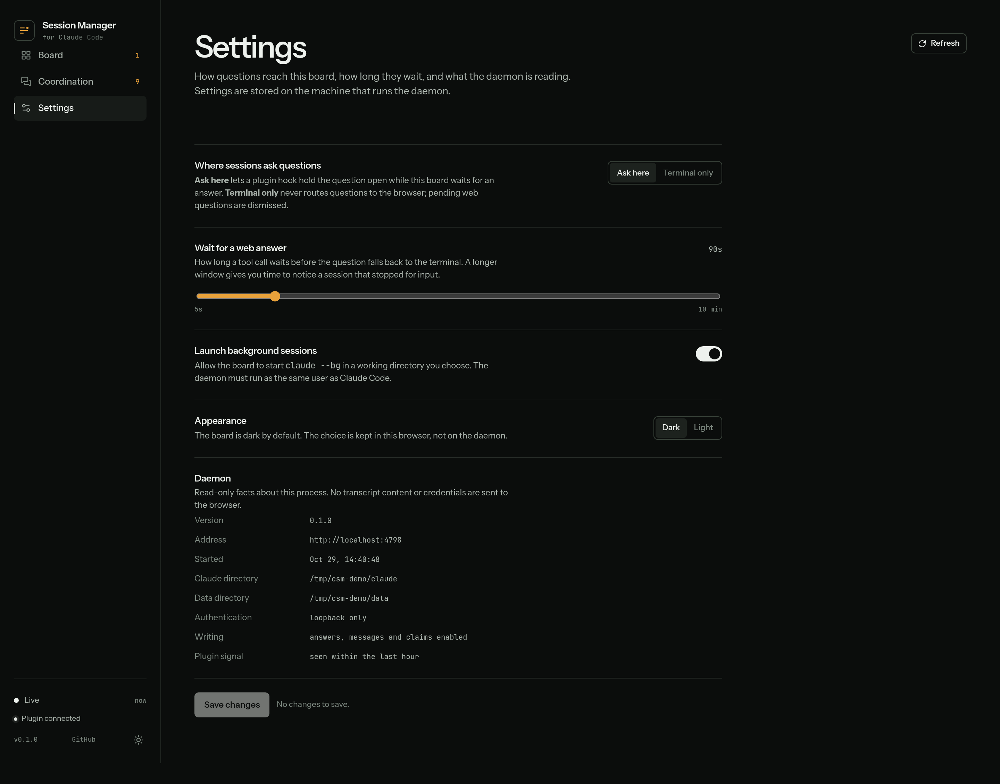
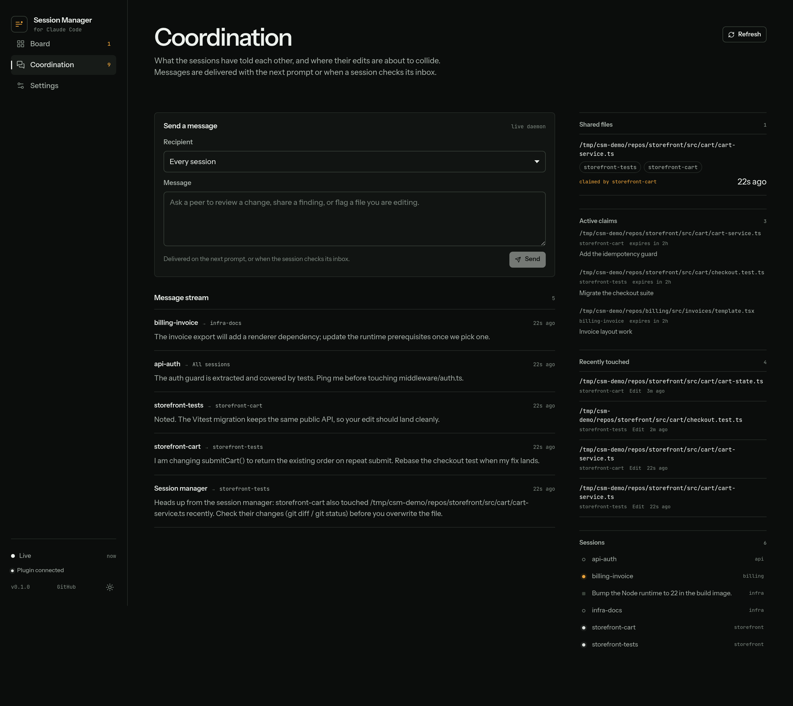
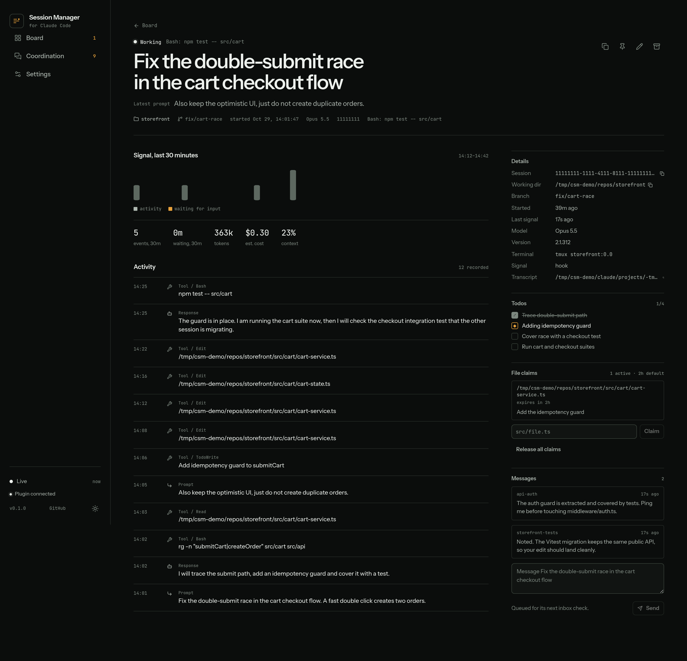
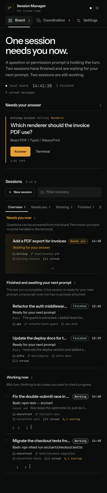

# Claude Session Manager

[](https://github.com/fabioudev/claude-session-manager/actions/workflows/ci.yml)
[](LICENSE)
[](https://nodejs.org)

A self-hosted web control plane for Claude Code sessions running on one machine.

The board shows what every session is working on, which project it belongs to, which repository
and branch it is in, and whether it is working, waiting or finished. When a session asks a
question, the question appears on the board and you can answer it from the browser — the terminal
does not need focus.

A Claude Code plugin connects the sessions. It reports their lifecycle and tool activity, and it
teaches each session that the other sessions exist, so they can message each other, warn about
overlapping edits and review each other's changes before overwriting them.



> The screenshots use fabricated demo sessions from `acme` repositories. No real session content
> is published.

## What you get

- **Live board** — a one-line mission headline, current step, status, project, repository, branch
  and a 30-minute signal trace for every session, including background jobs and finished sessions.
- **Questions in the browser** — `AskUserQuestion` prompts are held by a hook and answered from the
  board. Option descriptions, multiple questions and free-form answers are supported.
- **Session detail** — activity ledger, todos, token usage, context percentage, file claims,
  transcript path and peer messages.
- **Coordination** — an MCP server for listing peers, sending messages, reading an inbox, checking
  shared file changes and claiming files. Overlaps are detected from `PostToolUse` edits.
- **Teaches coexistence** — a session start context tells each session who else is running and how
  to coordinate; every prompt gets a digest of new messages, overlaps and active claims.
- **Self-hosted and small** — one Node process, a JSON state file, no database, no account, no
  telemetry. Loopback-only by default.

## How it works



The daemon also works without the plugin: it watches `~/.claude/projects/**/*.jsonl` and derives
status, tasks and activity from transcripts. The plugin adds instant hook events, the question
bridge and coordination.

## Install

Requirements:

- Node.js 22 or newer
- Claude Code with plugin support

### 1. Start the daemon

From source:

```bash
git clone https://github.com/fabioudev/claude-session-manager.git
cd claude-session-manager
npm install
npm run build
npm start
```

Open <http://127.0.0.1:4747>. To run `csm` from anywhere:

```bash
npm link
csm --open
```

Or use Docker:

```bash
cp .env.example .env              # set CSM_TOKEN to a long random value
docker compose up -d --build
```

The container reads `~/.claude` read-only and keeps state in a named volume. Because the state
directory is not on the host, host plugins reach the container with `CSM_URL=http://127.0.0.1:4747`
and `CSM_TOKEN=<the same token>`. Launching new Claude Code sessions is not supported from inside
the container; answer questions and coordinate from there.

### 2. Install the Claude Code plugin

In a Claude Code session:

```text
/plugin marketplace add fabioudev/claude-session-manager
/plugin install csm@claude-session-manager
```

Restart Claude Code or start a new session. The sidebar should show **Plugin connected** after the
first hook event. `/csm:status` prints the board summary inside a session.

## Answering questions



When a session calls `AskUserQuestion`, the plugin's `PreToolUse` hook holds the tool call open and
posts the question to the daemon. The question card shows the options, descriptions and a countdown.
The answer is returned to Claude as the denied tool call's reason, so the session continues exactly
as if you had answered in the terminal.

The **Terminal** button releases the question immediately. If nobody answers within the timeout
(90 seconds by default, 5–600 seconds in Settings), the question falls back to the terminal.

Two modes are available in **Settings → Where sessions ask questions**:

| Mode              | Behaviour                                                                 |
| ----------------- | ------------------------------------------------------------------------- |
| **Ask here**      | Hold the question for the board; fall back to the terminal on timeout.    |
| **Terminal only** | Never route questions to the browser; Claude Code uses its normal prompt. |

The browser never executes tools. It only delivers the answer text.

Settings also hold the wait timeout, the launch toggle and the appearance choice, and show the
daemon's paths, version and write state:



## Coordination



On `SessionStart` the plugin injects a short working agreement: other sessions are real, here are
their names and tasks, use the `csm` MCP tools, check `shared_changes` before editing, claim files
before risky edits. On every prompt it appends a compact digest of unread messages, files touched
by more than one session and active claims.

| MCP tool         | Purpose                                                            |
| ---------------- | ------------------------------------------------------------------ |
| `list_sessions`  | Every session: status, project, repository, task, pending question |
| `get_session`    | One session: todos, recent activity, unread messages               |
| `send_message`   | Message one session or broadcast to all                            |
| `read_inbox`     | Read and clear this session's messages                             |
| `shared_changes` | Recently changed files, overlaps and claims                        |
| `claim_files`    | Announce files this session is about to edit                       |
| `release_files`  | Release claims                                                     |

Messages are delivered on the recipient's next prompt or through `read_inbox`. Claims expire
automatically. When two sessions edit the same file within a two-hour window, the board marks an
overlap and the editing session gets a warning with the other session's name.

Useful commands inside a session:

| Command           | Purpose                                       |
| ----------------- | --------------------------------------------- |
| `/csm:status`     | Board summary grouped by what needs attention |
| `/csm:inbox`      | Read peer messages                            |
| `/csm:coordinate` | Check overlaps and claims before editing      |
| `/csm:message`    | Send a message to a peer or everyone          |

## The board



| Status    | Meaning                                                               |
| --------- | --------------------------------------------------------------------- |
| `working` | A tool is running or the transcript is actively growing               |
| `waiting` | A question, permission prompt or blocked background job needs a human |
| `idle`    | The turn finished; the session is ready for the next prompt           |
| `ended`   | The process is gone, the job finished, or the transcript is stale     |

The board opens on **Overview**, which puts your turn first: _Needs you now_, _Finished and
awaiting your next prompt_, _Working now_ and _No live signal_. Every row leads with a one-line
mission headline derived from the session's first prompt, so the board answers "what is this
session doing?" before you open it; when a transcript starts with a Claude Code compaction summary,
the headline is taken from the original request inside it. The meta line names the project — the
top-level workspace folder under your home directory — so a sub-repo, package or worktree still
reports the workspace it belongs to, followed by the repository and branch. Renaming a session
replaces the generated headline. The tabs narrow the list to Needs you, Working, Finished, Ended or Archived. A
finished row carries a green **Finished** badge, the last reply (or the original task when there is
no reply), the exact time the turn finished and how long it has been waiting, so you can tell at a
glance which session concluded and which is still running. **New session** starts `claude --bg` in
a directory you choose when launching is enabled in Settings; background jobs can be stopped from
the board. Interactive sessions must be closed in their terminal.

The same board on a phone:



## CLI

```text
csm [options]        start the daemon
csm doctor           check Node, Claude directory, transcripts, data dir and web bundle
csm --version
csm --help
```

| Option              | Default                     | Meaning                                             |
| ------------------- | --------------------------- | --------------------------------------------------- |
| `--host <host>`     | `127.0.0.1`                 | Bind address                                        |
| `--port <port>`     | `4747`                      | HTTP port                                           |
| `--data-dir <path>` | `~/.claude-session-manager` | State, settings and `client.json`                   |
| `--claude-dir <p>`  | `~/.claude`                 | Claude Code data directory                          |
| `--token <secret>`  | none                        | Require a bearer token for every API call           |
| `--read-only`       | off                         | Observation only; no answers, messages or launching |
| `--open`            | off                         | Open the board in the default browser               |
| `--log-level <lvl>` | `info`                      | `fatal` … `trace`                                   |
| `--allow-insecure`  | off                         | Allow a non-loopback bind without a token           |

Environment variables: `CSM_HOST`, `CSM_PORT`, `CSM_DATA_DIR`, `CSM_CLAUDE_DIR`, `CSM_TOKEN`,
`CSM_READ_ONLY`, `CSM_ALLOW_INSECURE`, `CSM_LOG_LEVEL`, `CSM_NO_BROWSER`.

### Remote access

The daemon refuses a non-loopback bind without a token. For a LAN or VPN board:

```bash
csm --host 0.0.0.0 --token "$(openssl rand -hex 24)" --open
```

Open `http://<host>:4747/?token=<token>` once. The UI keeps the token in `localStorage` and strips
it from the address bar. Put an HTTPS reverse proxy in front of the daemon for anything beyond a
trusted network; the token travels as a bearer header, except in the one-time link and the SSE
stream. If the proxy buffers SSE (some tunnels do), the board notices the silent stream and keeps
itself current with a five-second polling fallback.

## HTTP API

All routes are under `/api`. When a token is configured, send `Authorization: Bearer <token>`
(or `X-CSM-Token`). Hook and MCP routes are used by the plugin.

| Method   | Route                      | Purpose                               |
| -------- | -------------------------- | ------------------------------------- |
| `GET`    | `/health`                  | Liveness, version, start time         |
| `GET`    | `/config`                  | Public settings and daemon paths      |
| `GET`    | `/sessions`                | Session summaries                     |
| `GET`    | `/sessions/:id`            | Session detail                        |
| `PATCH`  | `/sessions/:id`            | Rename, pin or archive                |
| `POST`   | `/sessions/:id/inbox/read` | Read and clear a session's inbox      |
| `POST`   | `/sessions/:id/claims`     | Claim files                           |
| `DELETE` | `/sessions/:id/claims`     | Release claims                        |
| `POST`   | `/sessions/:id/stop`       | Stop a background job                 |
| `GET`    | `/questions`               | Pending questions                     |
| `POST`   | `/questions/:id/answer`    | Answer a held question                |
| `POST`   | `/questions/:id/dismiss`   | Release a question to the terminal    |
| `GET`    | `/coordination`            | Messages, claims, overlaps, touches   |
| `GET`    | `/messages`                | Message stream                        |
| `POST`   | `/messages`                | Send a message                        |
| `POST`   | `/launch`                  | Start a background session            |
| `PATCH`  | `/settings`                | Question mode, timeout, launch toggle |
| `GET`    | `/events`                  | Server-sent events                    |
| `POST`   | `/hooks/event`             | Plugin hook bridge                    |
| `POST`   | `/mcp/messages`            | Plugin MCP: send a message            |
| `GET`    | `/mcp/inbox`               | Plugin MCP: read inbox                |
| `POST`   | `/mcp/claims`              | Plugin MCP: claims and shared changes |

## Data and privacy

Everything stays on the machine that runs the daemon.

- **Transcripts** are read from `~/.claude/projects` and watched incrementally. The web UI shows
  task titles, activity metadata (tool names, commands, file paths) and, in the transcript-derived
  ledger, prompt and response text. Transcripts may contain tool output, including file contents;
  the daemon parses them locally and does not send them anywhere.
- **State** lives in `~/.claude-session-manager` with mode `0700`; `client.json` and `state.json`
  are written atomically with mode `0600`. It contains session metadata, messages, claims and
  settings — no file contents.
- **The plugin** sends tool metadata (paths, commands, AskUserQuestion input) to the daemon on
  loopback. It never sends file contents and fails soft: without the daemon Claude Code behaves as
  if the plugin were absent.
- **No telemetry**, no external services and no accounts. Fonts are bundled; the UI loads nothing
  from the network.

Do not expose the board to the public internet without a token and TLS. Anyone who can reach the
API can read session metadata, answer questions and send messages as you. See [SECURITY.md](SECURITY.md).

## Development

```bash
npm run dev          # tsx watch daemon + Vite dev server
npm run typecheck    # server and web TypeScript projects
npm run lint         # Biome
npm test             # Vitest
npm run build        # Vite web bundle + tsc server bundle
```

Layout:

```text
server/        Fastify daemon, transcript parser, session manager, coordination
shared/        Wire types shared by the server, web UI and tests
web/           React 19 + Vite board (no component library)
plugin/        Claude Code plugin: hooks, MCP server, commands, skill
tests/         Vitest suites for parser, state, pricing, questions, coordination
docs/          Screenshots used by this README
```

The built app is `dist/server/main.js` plus `dist/web`. `npm start` serves both on one port.
To run against a sandbox instead of your real sessions:

```bash
csm --claude-dir /tmp/claude-demo --data-dir /tmp/csm-data --port 4748
```

See [CONTRIBUTING.md](CONTRIBUTING.md) for the development workflow and
[plugin/README.md](plugin/README.md) for the plugin API details.

## Troubleshooting

**The board says “Plugin not connected”.** The plugin is not installed for this project, or no hook
has fired yet. Run `/plugin`, start a new session, then check `/csm:status`.

**`csm doctor` says the web bundle is missing.** Run `npm run build` before `npm start`.

**Questions never appear in the browser.** Settings may be on **Terminal only**, or the session is
not reporting hooks. Check `csm doctor` and the daemon URL/token.

**Port already in use.** Pass `--port <port>` or stop the other daemon. `csm doctor` shows the
running instance.

**Sessions show `unknown`.** No transcript, registry or hook signal yet. Start a new Claude Code
session or check `--claude-dir`.

**Remote board returns 401.** Open the URL once with `?token=…`, or set `CSM_TOKEN` and
`Authorization` consistently.

## Roadmap

- Session search across transcripts and messages
- A tmux/iTerm focus button for interactive sessions
- Per-project coordination rules and notification webhooks
- Transcript retention controls

## License

MIT — see [LICENSE](LICENSE).
