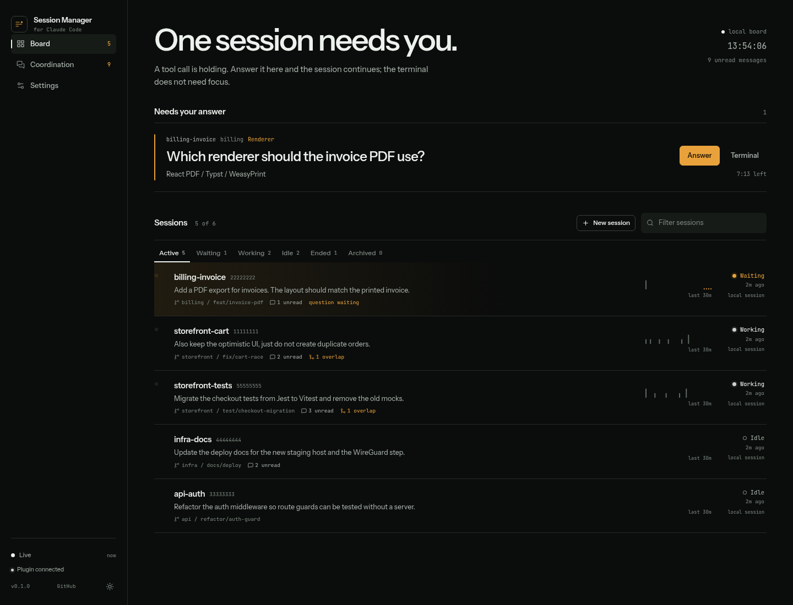
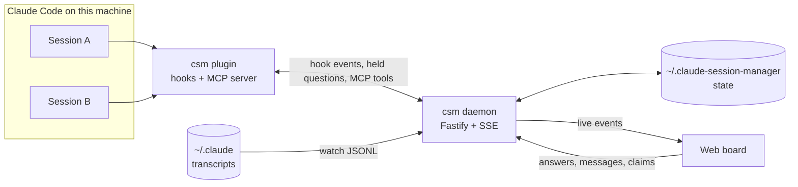
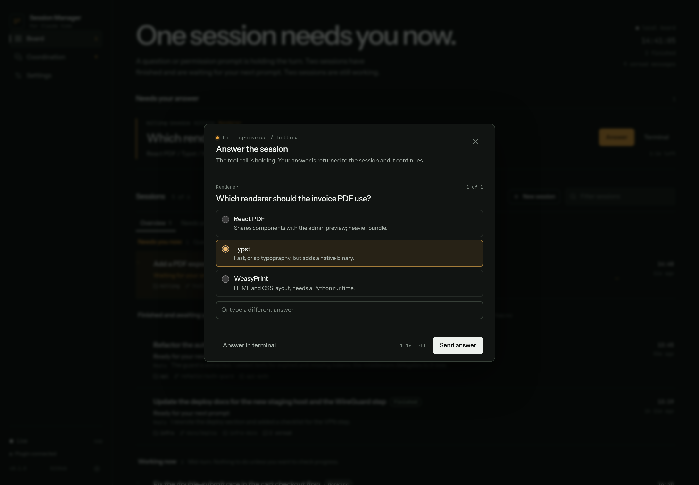
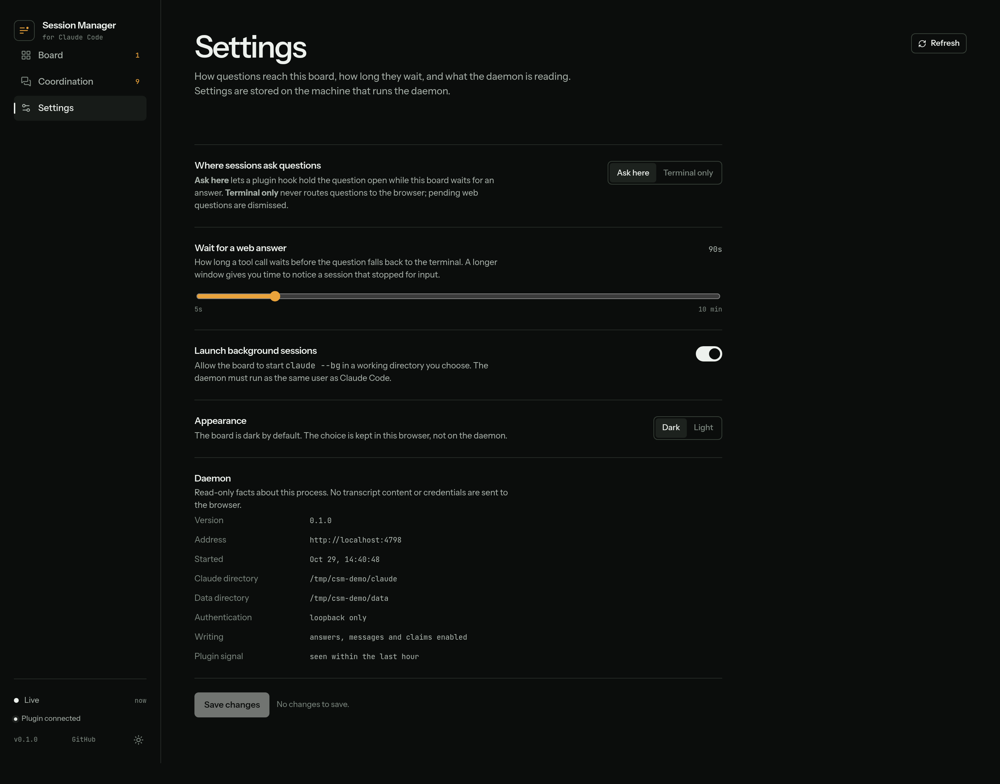
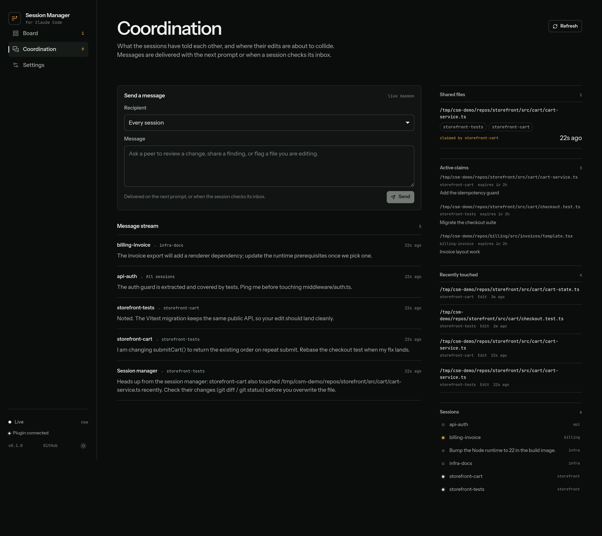
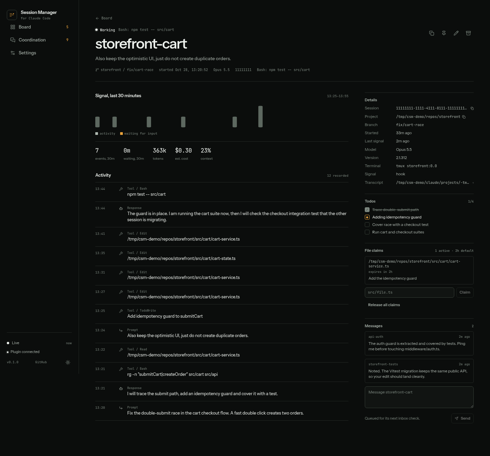
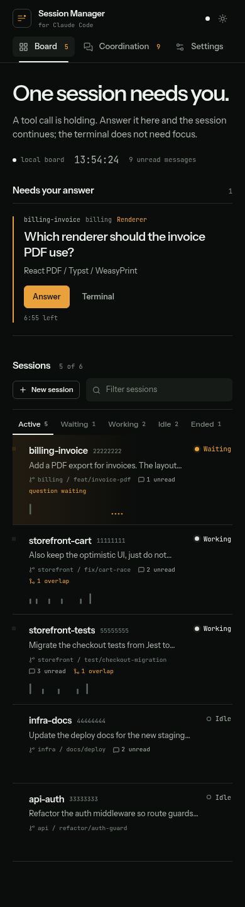

# Claude Session Manager

[](https://github.com/fabioudev/claude-session-manager/actions/workflows/ci.yml)
[](LICENSE)
[](https://nodejs.org)

A self-hosted web control plane for Claude Code sessions running on one machine.

The command center gives one main session a high-level goal, lets it delegate durable tasks to the
other sessions, and keeps progress, decisions and shared knowledge in one place. The separate
session board shows what every session is working on, which project it belongs to, which repository
and branch it is in, and whether it is working, waiting or finished. When a session asks a
question, the question appears in the browser and you can answer it there — the terminal does not
need focus.

A Claude Code plugin connects the sessions. It reports their lifecycle and tool activity, and it
teaches each session that the other sessions exist, so they can message each other, warn about
overlapping edits and review each other's changes before overwriting them.



> The screenshots use fabricated demo sessions from `acme` repositories. No real session content
> is published.

## What you get

- **Command center** — give a goal and follow delegated work through queue, in motion, blocked,
  review and done. The first command starts a dedicated commander automatically (or resumes the
  selected one); it receives a snapshot of sessions, tasks, decisions and knowledge up front.
  Decisions and unavailable workers are collected under **Needs you**.
- **Durable task ledger** — assignment, priority, explicit progress, notes, results, delivery state,
  revisions and activity history survive daemon restarts. Workers finish in review; the commander
  or human verifies and closes the task.
- **Shared knowledge** — durable decisions and conventions can be global or scoped to a project and
  its child directories. Pinned entries enter every relevant prompt; all active entries are
  available at session start and through `list_knowledge`.
- **Live board** — a one-line mission headline, current step, status, project, repository, branch
  and a 30-minute signal trace for every session, including background jobs and finished sessions.
- **Questions in the browser** — `AskUserQuestion` prompts are held by a hook and answered from the
  board. Option descriptions, multiple questions and free-form answers are supported.
- **Session detail** — activity ledger, todos, token usage, context percentage, file claims,
  transcript path and peer messages.
- **Coordination** — an MCP server for listing peers, sending messages, reading an inbox, checking
  shared file changes and claiming files. Overlaps are detected from `PostToolUse` edits.
- **Teaches coexistence** — a session start context tells each session who else is running and how
  to coordinate; every prompt gets a digest of new messages, overlaps and active claims.
- **Self-hosted and small** — one Node process, a JSON state file, no database, no account, no
  telemetry. Loopback-only by default.

## How it works



The daemon also works without the plugin: it watches `~/.claude/projects/**/*.jsonl` and derives
status, tasks and activity from transcripts. The plugin adds instant hook events, the question
bridge and coordination.

## Command center

Open `/` and type a goal. With no **Main session** selected, the first command launches a dedicated
`Commander` session in its own tmux pane and adopts it; a selected commander that went offline is
resumed with its existing transcript. Launching follows the same settings as any other session, and
the picker still allows choosing a specific live session instead (`CSM_COMMANDER_CWD` changes the
working directory, default `~`). The original session board remains at `/sessions`.

The commander runs in tmux rather than as a background job on purpose: a background job cannot take
typed input, and the daemon that owns it dies with the service's process group. A tmux pane survives
daemon restarts, so later commands are typed straight into the live commander. Commands that arrive
while it is working wait in the inbox; when it comes to rest the board types them itself.

The command prompt is self-contained. Besides the human goal it carries a bounded snapshot of live
sessions (exact ids, status, project, current task, pending question), open delegated tasks with
assignees and latest notes, unresolved human decisions, and active shared knowledge. The commander
can plan immediately and calls `get_command_center` only when it wants fresher state. It is told to
delegate in the same turn instead of only planning, to accept a new goal for a different project at
any time, and to keep monitoring what it started.

Under the command box sits the newest commander report — one compact card with its status, author,
time and title. **Show complete** expands a truncated body in place, and **History** opens the full
conversation in a dialog: your goals on the right, the commander's `report_status` reports on the
left, and automatic ledger lines (delegated, in progress, ready for review, blocked, completed,
waiting on you) in between. **Features in flight** groups all open tasks by project, with a
declared-progress bar, running/review/blocked counts and the individual tasks — so "which feature is
being worked on, and where does it stand?" is answered without opening anything.

The commander is a dispatcher, not a second worker. Its prompt forbids reading repository code,
grepping, building, testing, editing files or spawning subagents, and the launcher denies it the
tools that would execute such work (`--disallowedTools Bash,Edit,Write,MultiEdit,NotebookEdit,Task`).
Facts it does not have belong in a task brief or a delegated read-only discovery task; durable notes
go through `share_knowledge`, never `curl` against the manager API.

Assignment dispatches the task automatically. `typed` means the prompt was entered into a live
pane; `queued` means it waits in the session inbox. Neither state proves execution: progress and
status change only when the worker reports them (or when the human edits the task in the UI).
Workers report `in_progress`, `blocked` or `review`, a percentage, notes and a result. Only the
main session or a human can mark work `done` or `cancelled`. Revisions reject stale concurrent
updates instead of overwriting a newer report.

A worker calls `request_decision` when only the human can unblock it. The durable question appears
under **Needs you**, optionally blocking its linked task. Your answer is saved and sent to the
requesting session; existing `AskUserQuestion` cards appear in the same area.

Knowledge is not scraped from conversations. Add it deliberately in the UI or with
`share_knowledge`: a title, body, optional tags and an optional absolute project path. Only the
commander or human can pin an entry into every prompt. Workers can publish unpinned notes for
their peers. Archived entries remain in the ledger but are no longer injected.

### Epics: one stable page per large goal

A large goal that spans repositories should not live only in the commander chat, where routine
updates bury it. That is what an **epic** is: a durable record with a title, a goal, the declared
repositories, an optional preview URL and a deliberately short **status line** the human reads at a
glance. **Epics** in the rail lists every open epic as a card — status pill, status line,
repositories, preview link, task rollup and the epic commander — plus a **Braucht dich** strip for
threads with unanswered questions, results awaiting acceptance and blocked tasks. Open tasks that
belong to no epic stay visible under **Ohne Epic**.

Tasks carry an `epicId`; the rollup and progress are derived from them, never maintained by hand.
Each epic has its own thread: write a question or remark there and it is delivered to the epic's
commander — immediately when it is live, otherwise at its next prompt — and answered in the same
thread with `post_epic_message`, so the main chat stays a command intake.

The main commander opens epics (`create_epic`), attaches tasks with `epic_id` and starts a
dedicated **epic commander** per epic with `spawn_epic_commander`. That session owns the epic for
its lifetime: it plans, splits into tasks, dispatches workers, reviews their results and keeps the
status line current. Its write access is limited to its own epic and its tasks. The main commander
keeps intake, cross-epic dispatch and milestones. When an epic commander ends, the epic becomes
unowned and the main commander is nudged to start a new one; closing an epic (`done` or
`cancelled`) records `completedAt` and moves it to the closed list.

The command ledger lives in `<dataDir>/command-center.json`, independently of `state.json`, and is
written atomically. A corrupt file is moved aside before an empty ledger is started. There is no
autonomous scheduler and no automatic task completion.

## Install

Requirements:

- Node.js 22 or newer
- Claude Code with plugin support

### 1. Start the daemon

From source:

```bash
git clone https://github.com/fabioudev/claude-session-manager.git
cd claude-session-manager
npm install
npm run build
npm start
```

Open <http://127.0.0.1:4747>. To run `csm` from anywhere:

```bash
npm link
csm --open
```

Or use Docker:

```bash
cp .env.example .env              # set CSM_TOKEN to a long random value
docker compose up -d --build
```

The container reads `~/.claude` read-only and keeps state in a named volume. Because the state
directory is not on the host, host plugins reach the container with `CSM_URL=http://127.0.0.1:4747`
and `CSM_TOKEN=<the same token>`. Launching new Claude Code sessions is not supported from inside
the container; answer questions and coordinate from there.

### 2. Install the Claude Code plugin

In a Claude Code session:

```text
/plugin marketplace add fabioudev/claude-session-manager
/plugin install csm@claude-session-manager
```

Restart Claude Code or start a new session. The sidebar should show **Plugin connected** after the
first hook event. `/csm:status` prints the board summary inside a session.

### Keeping Claude Code and the plugin current

- **Claude Code** updates itself: native installs download new versions in the background and use
  them the next time a session starts. Homebrew, WinGet and distro packages update through their
  package manager; `claude update` does it by hand in every case.
- **The plugin** updates from its marketplace. Marketplaces you add yourself, including this one,
  default to no automatic updates. Turn on **Auto-update** in `/plugin` → Marketplaces, or add it
  to your settings so it stays on:

  ```json
  {
    "extraKnownMarketplaces": {
      "claude-session-manager": {
        "source": { "source": "github", "repo": "fabioudev/claude-session-manager" },
        "autoUpdate": true
      }
    }
  }
  ```

  Claude Code then refreshes the marketplace and the installed plugin after the first message of a
  session (with a random delay of up to ten minutes), or run
  `claude plugin update csm@claude-session-manager` yourself. The new version loads in the next
  session, or immediately with `/reload-plugins`.

Running sessions keep the version they started with. The daemon reads the installed Claude Code and
plugin versions and flags every session that is behind — an **update ready** chip on the board and
a restart banner on the session page.

**Restart in place.** On Linux, when a session runs in a tmux pane, the session page can restart an
idle interactive session: it exits Claude Code, starts it again with `--resume` in the same pane,
and the conversation continues where it left off. _Settings → Restart sessions after updates_
(off by default) does the same automatically when a newer version is installed, but only after the
session has been quiet for three minutes. It never touches a session that is working, waiting for
an answer, or not running in tmux; a session is restarted at most once per installed version, and a
manual restart has a ten-minute cooldown. Sessions outside tmux need a manual restart in their
terminal. A session that has not had a first turn yet is refused (there is no conversation to
resume), and so is a pane with another program in the foreground — keystrokes would otherwise land
in that program.

**Resume an ended session.** While a session is live, the daemon remembers the command that started
it, including a launcher wrapper and its flags. When that session has ended, its page offers
_Resume_: csm starts a new detached tmux session in the same directory and runs the same command
with `--resume <session-id>`, so the conversation continues. A session the daemon only ever saw in
a transcript uses the **Session launcher** from Settings instead — a wrapper that carries
authentication or a default model, such as `ollama launch claude --model <model> --`, or plain
`claude` when the field is empty; the session page names the command it will use. A session without
a transcript is not offered. If the resume command crashes on startup, the last lines of the pane
are reported and the tmux session is removed again.

## Preview links

A session that serves a dev server or a tunnel can carry a **preview** link on the board and on its
page. There are three sources, in this order:

1. **A registration.** A session calls the `register_preview` tool with the port its dev server
   listens on (for example `register_preview { port: 5173 }`). The daemon registers the name and
   the preview router forwards `https://<name>.<zone>` to `127.0.0.1:<port>` until it expires
   (12 hours by default; asking again extends it). The zone is set in _Settings → Preview links_
   and the router's port with `CSM_PREVIEW_PORT` (8090 by default, `0` disables it).
2. **A project rule** in _Settings → Preview links_: `pattern = https://address` per line, matched
   against the project path and repository names. `*` is a wildcard.
3. **A URL in output.** Host suffixes such as `trycloudflare.com` or your own dev domain; subdomains
   match too.

| List                                   | Purpose                                                                                                         |
| -------------------------------------- | --------------------------------------------------------------------------------------------------------------- |
| **Preview zone**                       | The domain registered previews live under, for example `dev-fixplay.de`. Empty disables registrations.          |
| **Project rules**                      | `pattern = https://address` per line, matched against the project path and repository names. `*` is a wildcard. |
| **Hosts recognised in session output** | Host suffixes such as `trycloudflare.com` or your own dev domain; subdomains match too.                         |

A registration wins over a rule, and a rule wins over anything found in output. When no rule
matches, the newest `http(s)` URL a tool printed in the last day on one of the listed hosts becomes
the preview — a tunnel address, for example. Prose the session wrote itself is ignored: a URL in a
message may belong to a peer's tunnel, a documentation page or a command. Only `http`/`https` URLs
without embedded credentials are ever rendered, so a transcript cannot inject a `javascript:` link.
A rule such as `fixplay-diagnoseTool = https://dev-diagnosetool.example.com` covers a whole checkout;
`*admin* = https://dev-admin.example.com` covers worktrees and branches by name.

A registration can also carry `routes` for an app whose dev server does not serve its own API: the
longest matching path prefix goes to another loopback port instead, optionally with the prefix
stripped — `register_preview { port: 5176, routes: [{ prefix: '/api/', port: 7100 }] }`. Without
routes, a split frontend/backend setup shows a working page with a broken `/api`.

The router answers only for names registered right now, rewrites `Host` to `localhost:<port>` (Vite
and Nuxt reject unknown hosts) and tunnels WebSocket upgrades, so HMR works. It is loopback-only
unless you set `CSM_PREVIEW_BIND`; a non-loopback bind requires `CSM_PREVIEW_SECRET`, which the TLS
terminator must send as `x-preview-secret`. With `CSM_PREVIEW_PASSWORD` a visitor logs in once and a
signed, `HttpOnly` cookie then carries the page, its assets, XHRs and the HMR socket — apps keep
their own `Authorization` headers and redirects keep working. See [docs/preview-ingress.md](docs/preview-ingress.md)
for the Caddy configuration that terminates TLS for the zone and asks the daemon before it requests
a certificate.


## Answering questions



When a session calls `AskUserQuestion`, the plugin's `PreToolUse` hook holds the tool call open and
posts the question to the daemon. The question card shows the options, descriptions and a countdown.
The answer is returned to Claude as the denied tool call's reason, so the session continues exactly
as if you had answered in the terminal.

The **Terminal** button releases the question immediately. If nobody answers within the timeout
(90 seconds by default, 5–600 seconds in Settings), the question falls back to the terminal.

Two modes are available in **Settings → Where sessions ask questions**:

| Mode              | Behaviour                                                                 |
| ----------------- | ------------------------------------------------------------------------- |
| **Ask here**      | Hold the question for the board; fall back to the terminal on timeout.    |
| **Terminal only** | Never route questions to the browser; Claude Code uses its normal prompt. |

The browser never executes tools. It only delivers the answer text.

Settings also hold the wait timeout, the launch toggle, the session launcher and the appearance
choice, and show the daemon's paths, version and write state:



## Coordination



On `SessionStart` the plugin injects a short working agreement: other sessions are real, here are
their names and tasks, use the `csm` MCP tools, check `shared_changes` before editing, claim files
before risky edits. On every prompt it appends a compact digest of unread messages, files touched
by more than one session and active claims.

| MCP tool         | Purpose                                                            |
| ---------------- | ------------------------------------------------------------------ |
| `list_sessions`  | Every session: status, project, repository, task, pending question |
| `get_session`    | One session: todos, recent activity, unread messages               |
| `send_message`   | Message one session or broadcast to all                            |
| `read_inbox`     | Read and clear this session's messages                             |
| `shared_changes` | Recently changed files, overlaps and claims                        |
| `claim_files`    | Announce files this session is about to edit                       |
| `release_files`  | Release claims                                                     |

Messages are delivered on the recipient's next prompt or through `read_inbox`. A task entered on a
session page is different: a live, idle session gets it typed into its tmux pane and starts working
at once (multi-line text arrives as one bracketed paste). Everything else — ended, working, at a
question or a shell — falls back to the inbox, and the board says why. Claims expire
automatically. When two sessions edit the same file within a two-hour window, the board marks an
overlap and the editing session gets a warning with the other session's name.

Useful commands inside a session:

| Command           | Purpose                                       |
| ----------------- | --------------------------------------------- |
| `/csm:status`     | Board summary grouped by what needs attention |
| `/csm:inbox`      | Read peer messages                            |
| `/csm:coordinate` | Check overlaps and claims before editing      |
| `/csm:message`    | Send a message to a peer or everyone          |

## The board



| Status    | Meaning                                                               |
| --------- | --------------------------------------------------------------------- |
| `working` | A tool is running or the transcript is actively growing               |
| `waiting` | A question, permission prompt or blocked background job needs a human |
| `idle`    | The turn finished; the session is ready for the next prompt           |
| `ended`   | The process is gone, the job finished, or the transcript is stale     |

The board opens on **Overview**, which puts your turn first: _Needs you now_, _Finished and
awaiting your next prompt_, _Working now_ and _No live signal_. Every row leads with a one-line
mission headline derived from the session's first prompt, so the board answers "what is this
session doing?" before you open it; when a transcript starts with a Claude Code compaction summary,
the headline is taken from the original request inside it. The meta line names the project — the
top-level workspace folder under your home directory — so a sub-repo, package or worktree still
reports the workspace it belongs to, followed by the repository and branch. Renaming a session
replaces the generated headline. The tabs narrow the list to Needs you, Working, Finished, Ended or Archived. A
finished row carries a green **Finished** badge, the last reply (or the original task when there is
no reply), the exact time the turn finished and how long it has been waiting, so you can tell at a
glance which session concluded and which is still running. **New session** starts `claude --bg` in
a directory you choose when launching is enabled in Settings; background jobs can be stopped from
the board. Interactive sessions must be closed in their terminal.

The same board on a phone:



## CLI

```text
csm [options]        start the daemon
csm doctor           check Node, Claude directory, transcripts, data dir and web bundle
csm --version
csm --help
```

| Option              | Default                     | Meaning                                             |
| ------------------- | --------------------------- | --------------------------------------------------- |
| `--host <host>`     | `127.0.0.1`                 | Bind address                                        |
| `--port <port>`     | `4747`                      | HTTP port                                           |
| `--data-dir <path>` | `~/.claude-session-manager` | State, settings and `client.json`                   |
| `--claude-dir <p>`  | `~/.claude`                 | Claude Code data directory                          |
| `--token <secret>`  | none                        | Require a bearer token for every API call           |
| `--read-only`       | off                         | Observation only; no answers, messages or launching |
| `--open`            | off                         | Open the board in the default browser               |
| `--log-level <lvl>` | `info`                      | `fatal` … `trace`                                   |
| `--allow-insecure`  | off                         | Allow a non-loopback bind without a token           |

Environment variables: `CSM_HOST`, `CSM_PORT`, `CSM_DATA_DIR`, `CSM_CLAUDE_DIR`, `CSM_TOKEN`,
`CSM_READ_ONLY`, `CSM_ALLOW_INSECURE`, `CSM_LOG_LEVEL`, `CSM_NO_BROWSER`.

### Remote access

The daemon refuses a non-loopback bind without a token. For a LAN or VPN board:

```bash
csm --host 0.0.0.0 --token "$(openssl rand -hex 24)" --open
```

Open `http://<host>:4747/?token=<token>` once. The UI keeps the token in `localStorage` and strips
it from the address bar. Put an HTTPS reverse proxy in front of the daemon for anything beyond a
trusted network; the token travels as a bearer header, except in the one-time link and the SSE
stream. If the proxy buffers SSE (some tunnels do), the board notices the silent stream and keeps
itself current with a five-second polling fallback.

## HTTP API

All routes are under `/api`. When a token is configured, send `Authorization: Bearer <token>`
(or `X-CSM-Token`). Hook and MCP routes are used by the plugin.

| Method   | Route                      | Purpose                                        |
| -------- | -------------------------- | ---------------------------------------------- |
| `GET`    | `/health`                  | Liveness, version, start time                  |
| `GET`    | `/config`                  | Public settings and daemon paths               |
| `GET`    | `/sessions`                | Session summaries                              |
| `GET`    | `/sessions/:id`            | Session detail                                 |
| `PATCH`  | `/sessions/:id`            | Rename, pin or archive                         |
| `POST`   | `/sessions/:id/prompt`     | Type a task into a live session                |
| `POST`   | `/sessions/:id/inbox/read` | Read and clear a session's inbox               |
| `POST`   | `/sessions/:id/claims`     | Claim files                                    |
| `DELETE` | `/sessions/:id/claims`     | Release claims                                 |
| `POST`   | `/sessions/:id/stop`       | Stop a background job                          |
| `GET`    | `/questions`               | Pending questions                              |
| `POST`   | `/questions/:id/answer`    | Answer a held question                         |
| `POST`   | `/questions/:id/dismiss`   | Release a question to the terminal             |
| `GET`    | `/coordination`            | Messages, claims, overlaps, touches            |
| `GET`    | `/messages`                | Message stream                                 |
| `POST`   | `/messages`                | Send a message                                 |
| `POST`   | `/launch`                  | Start a background session                     |
| `PATCH`  | `/settings`                | Settings, including preview links              |
| `GET`    | `/command-center`          | Tasks, knowledge, decisions, commands, channel |
| `PUT`    | `/commander`               | Choose the main session                        |
| `POST`   | `/commander/command`       | Send a goal to the main session                |
| `POST`   | `/commander/updates`       | Commander report for the channel               |
| `POST`   | `/tasks`                   | Create and auto-dispatch a task                |
| `PATCH`  | `/tasks/:id`               | Report or edit a task                          |
| `POST`   | `/tasks/:id/dispatch`      | Deliver a task again                           |
| `POST`   | `/knowledge`               | Share knowledge                                |
| `PATCH`  | `/knowledge/:id`           | Edit, pin or archive knowledge                 |
| `POST`   | `/decisions`               | Ask the human, optionally blocking             |
| `POST`   | `/decisions/:id/resolve`   | Answer a decision                              |
| `GET`    | `/events`                  | Server-sent events                             |
| `POST`   | `/hooks/event`             | Plugin hook bridge                             |
| `POST`   | `/mcp/messages`            | Plugin MCP: send a message                     |
| `GET`    | `/mcp/inbox`               | Plugin MCP: read inbox                         |
| `POST`   | `/mcp/claims`              | Plugin MCP: claims and shared changes          |
| `POST`   | `/mcp/preview`             | Plugin MCP: register a preview port            |
| `DELETE` | `/mcp/preview`             | Plugin MCP: drop the preview                   |
| `GET`    | `/previews`                | Live preview registrations                     |
| `GET`    | `/previews/ask`            | TLS gate for on-demand certificates            |

## Data and privacy

Everything stays on the machine that runs the daemon.

- **Transcripts** are read from `~/.claude/projects` and watched incrementally. The web UI shows
  task titles, activity metadata (tool names, commands, file paths) and, in the transcript-derived
  ledger, prompt and response text. Transcripts may contain tool output, including file contents;
  the daemon parses them locally and does not send them anywhere.
- **State** lives in `~/.claude-session-manager` with mode `0700`; `client.json`, `state.json` and
  `command-center.json` are written atomically with mode `0600`. It contains session metadata,
  messages, claims, settings, task briefs, knowledge entries and human decisions — no transcripts
  or file contents.
- **The plugin** sends tool metadata (paths, commands, AskUserQuestion input) to the daemon on
  loopback. It never sends file contents and fails soft: without the daemon Claude Code behaves as
  if the plugin were absent.
- **No telemetry**, no external services and no accounts. Fonts are bundled; the UI loads nothing
  from the network.

Do not expose the board to the public internet without a token and TLS. Anyone who can reach the
API can read session metadata, answer questions and send messages as you. See [SECURITY.md](SECURITY.md).

## Development

```bash
npm run dev          # tsx watch daemon + Vite dev server
npm run typecheck    # server and web TypeScript projects
npm run lint         # Biome
npm test             # Vitest
npm run build        # Vite web bundle + tsc server bundle
```

Layout:

```text
server/        Fastify daemon, transcript parser, session manager, coordination
shared/        Wire types shared by the server, web UI and tests
web/           React 19 + Vite board (no component library)
plugin/        Claude Code plugin: hooks, MCP server, commands, skill
tests/         Vitest suites for parser, state, pricing, questions, coordination
docs/          Screenshots used by this README
```

The built app is `dist/server/main.js` plus `dist/web`. `npm start` serves both on one port.
To run against a sandbox instead of your real sessions:

```bash
csm --claude-dir /tmp/claude-demo --data-dir /tmp/csm-data --port 4748
```

See [CONTRIBUTING.md](CONTRIBUTING.md) for the development workflow and
[plugin/README.md](plugin/README.md) for the plugin API details.

## Troubleshooting

**The board says “Plugin not connected”.** The plugin is not installed for this project, or no hook
has fired yet. Run `/plugin`, start a new session, then check `/csm:status`.

**`csm doctor` says the web bundle is missing.** Run `npm run build` before `npm start`.

**Questions never appear in the browser.** Settings may be on **Terminal only**, or the session is
not reporting hooks. Check `csm doctor` and the daemon URL/token.

**Port already in use.** Pass `--port <port>` or stop the other daemon. `csm doctor` shows the
running instance.

**Sessions show `unknown`.** No transcript, registry or hook signal yet. Start a new Claude Code
session or check `--claude-dir`.

**Remote board returns 401.** Open the URL once with `?token=…`, or set `CSM_TOKEN` and
`Authorization` consistently.

## Roadmap

- Session search across transcripts and messages
- A tmux/iTerm focus button for interactive sessions
- Per-project coordination rules and notification webhooks
- Transcript retention controls

## License

MIT — see [LICENSE](LICENSE).
